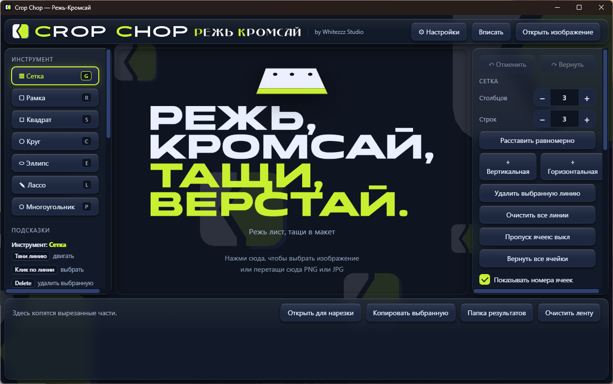

<p align="center">
  
</p>

# Crop Chop

**Cut precisely. Drag instantly.** A Windows app that slices a sheet of icons, marks or UI elements into separate pieces and lets you drag each piece straight into Figma, File Explorer or any other window.

[Русская версия](README.md) · [Download](https://github.com/whitezzz1933-dotcom/whitezzz-crop-chop/releases) · by Whitezzz Studio

> **Status: 0.1.0-alpha.** This is an early version. It works, but it is not fully polished. Please report bugs and ideas in Issues.



## What it is for

You have one big sheet with dozens of icons (from generation, a scan or an asset pack) and you want separate files. Crop Chop does it without plugins and without internet: open the image, place the lines, get clean pieces and drag them where you need them.

## Features

- **Grid:** columns and rows, even spacing, your own lines (move, add, delete with the mouse).
- **Smart grid by gaps:** finds empty strips between marks and places lines along them.
- **Shapes:** frame, square, circle, ellipse, lasso (by points, with contour closing), polygon (regular shapes with rotation and rounding).
- **Skip cells:** mark cells you do not want to cut, or turn on "Skip empty cells".
- **Trim empty margins** around each piece.
- **"Open for slicing":** take a cut piece from the strip and slice it again.
- **Strip:** all cut pieces collect at the bottom; select, copy or clear them.
- **Drag and drop:** pull a piece from the strip into Figma or File Explorer.
- **Undo and redo** for markup (lines and shapes).
- **Works offline.** The app does not send your images to the internet: the code is open, you can check.

The interface is currently in Russian only; an English interface is planned.

## Download and install

All files are on the [Releases](https://github.com/whitezzz1933-dotcom/whitezzz-crop-chop/releases) page. Tested on Windows 11 (64-bit); Windows 10 should work but was not tested.

| File | What it is |
|---|---|
| `CropChop-Setup-0.1.0-alpha.exe` | installer (choose a folder, creates shortcuts) |
| `CropChop-0.1.0-alpha-portable.exe` | portable version, installs nothing |
| `SHA256SUMS.txt` | file checksums |

**Windows warning (SmartScreen).** The files are not code-signed yet, so Windows may show a blue "Windows protected your PC" window. This is expected for an unsigned app. To run it, click "More info", then "Run anyway". Signing is planned, if it works out. Run only files from this Releases page, and only after checking the checksum. Copies on other sites or in messengers are not mine.

**Verify the checksum** (PowerShell):

```powershell
Get-FileHash .\CropChop-Setup-0.1.0-alpha.exe -Algorithm SHA256
```

The result must match the line in `SHA256SUMS.txt`. The checksums are in that file and in the description of every release (they change when the app is rebuilt).

**Where results are saved.** In the `output` folder next to the program. If that folder is not writable, the app uses `Documents\Crop Chop\output`. The "Results folder" button opens it.

## How to use

1. Click "Open image" or drag a PNG or JPG onto the window.
2. Pick a tool on the left (Grid, Frame, Lasso and others) and place lines or a shape.
3. Click cut. Pieces appear in the strip below.
4. Drag a piece into Figma or File Explorer.

## Roadmap

Plans, no promises or dates.

- free grid nodes and "Merge cells";
- English interface next to Russian;
- X, Y, width, height and proportion fields;
- JPG and WebP formats, "Drag all";
- merge "Square" into "Frame" and "Circle" into "Ellipse" (proportions with Shift);
- version 0.2.0: a short "swish" animation when the result is ready, plus sound with an on/off switch.

## ☕ Buy the author a coffee

Crop Chop is free. If it helped you and you want to say thanks, you can support the author: [Yandex Tips](https://tips.yandex.ru/guest/payment/3995636) or by the QR code. It is voluntary and changes nothing.


## Important notes

- **Not affiliated with Figma.** Crop Chop is an independent project. Figma is a trademark of Figma, Inc. The app does not use the Figma API: it hands files over through ordinary drag and drop.
- **Code created with AI assistance.** Idea, design, testing and maintenance: Whitezzz Studio. The code was written with the help of a neural network under the author's direction.
- **Alpha.** Bugs are possible. Keep copies of your original files before working with important data.

## Build from source

Node.js and npm are required.

```powershell
git clone https://github.com/whitezzz1933-dotcom/whitezzz-crop-chop.git
cd whitezzz-crop-chop
npm install
npm start        # run in development mode
```

Build installer and portable: `npx electron-builder`. Output appears in `dist`.

**Keywords:** image slicer, sprite sheet splitter, icon sheet cutter, crop and drag to Figma, Electron, Windows.

## License and credits

Program code: [MIT](LICENSE).

Logo, mark, lettering and slogan © Whitezzz Studio. The MIT license covers the code only: the Crop Chop name, logo and visual identity are not licensed. The logo and slogan images use the fonts Advaken Sans (Vladislav Borisov), Beladonna Modern (Alexandra Gophmann) and Onder (Alisa Oleinikova). Font files are not included in the repository or in the app; the lettering is embedded as images.

Contact: Telegram [@Whitezz](https://t.me/Whitezz) (spelled with two z's) · channel [whitezzz_design](https://t.me/whitezzz_design). I have no other contacts and I never ask for payment for "activation", "tax" or "insurance". Bugs and ideas: [Issues](https://github.com/whitezzz1933-dotcom/whitezzz-crop-chop/issues).
