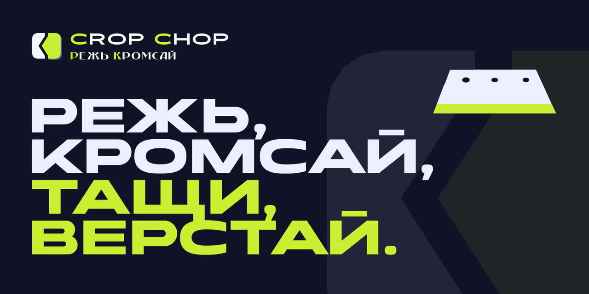
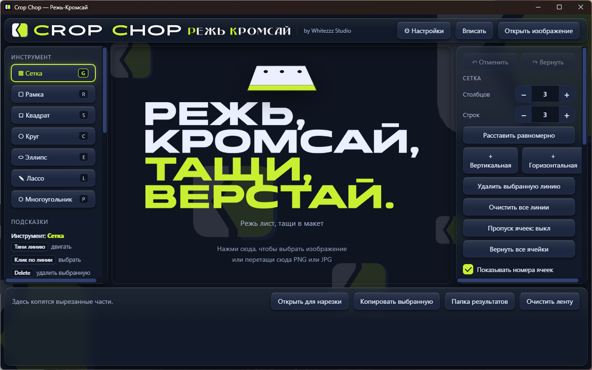

<p align="center">
  
</p>

# Crop Chop · Режь-Кромсай

**Режь, кромсай, тащи, верстай.** Программа для Windows, которая режет лист с иконками, значками или элементами интерфейса на отдельные части и даёт перетащить каждую часть прямо в Figma, в Проводник или в другое окно.

[English version](README.en.md) · [Скачать](https://github.com/whitezzz1933-dotcom/whitezzz-crop-chop/releases) · by Whitezzz Studio

> **Статус: 0.1.0-alpha.** Это ранняя версия. Она работает, но не всё отполировано. Об ошибках и пожеланиях пишите в Issues.



## Для чего это нужно

Вы получили один большой лист с десятками иконок (из генерации, из скана, из набора) и хотите разложить его по отдельным файлам. Crop Chop делает это без плагинов и без интернета: открываете картинку, расставляете линии, получаете аккуратные фрагменты и перетаскиваете их туда, где они нужны.

## Что умеет

- **Сетка:** столбцы и строки, равномерная расстановка, свои линии мышью (двигать, добавлять, удалять).
- **Умная сетка по промежуткам:** находит пустые полосы между знаками и ставит линии по ним.
- **Фигуры:** рамка, квадрат, круг, эллипс, лассо (по точкам с замыканием контура), многоугольник (правильные фигуры с поворотом и скруглением).
- **Пропуск ячеек:** отметьте ячейки, которые резать не нужно, или включите «Не вырезать пустые ячейки».
- **Обрезка пустых полей** вокруг каждого фрагмента.
- **«Открыть для нарезки»:** возьмите вырезанный фрагмент из ленты и нарежьте его ещё раз.
- **Лента:** все вырезанные части копятся внизу, их можно выбрать, скопировать или очистить.
- **Перетаскивание:** вытащите фрагмент из ленты в Figma или в Проводник.
- **Отмена и возврат** для всех действий.
- **Работает без интернета.** Изображения не покидают компьютер.

## Скачать и установить

Все файлы лежат на странице [Releases](https://github.com/whitezzz1933-dotcom/whitezzz-crop-chop/releases). Нужна Windows 10 или 11, 64-бит.

| Файл | Что это |
|---|---|
| `CropChop-Setup-0.1.0-alpha.exe` | установщик (можно выбрать папку, создаёт ярлыки) |
| `CropChop-0.1.0-alpha-portable.exe` | portable-версия, ничего не устанавливает |
| `SHA256SUMS.txt` | контрольные суммы файлов |

**Предупреждение Windows (SmartScreen).** Файлы пока не подписаны цифровой подписью, поэтому Windows может показать синее окно «Windows защитила ваш компьютер». Это ожидаемо для неподписанной программы. Чтобы запустить, нажмите «Подробнее», затем «Выполнить в любом случае». Подпись планируется после релиза. Если не хотите доверять на слово, сверьте контрольную сумму.

**Проверка контрольной суммы** (PowerShell):

```powershell
Get-FileHash .\CropChop-Setup-0.1.0-alpha.exe -Algorithm SHA256
```

Результат должен совпасть со строкой из `SHA256SUMS.txt`. Для версии 0.1.0-alpha:

```
31CF4EA216D1D13472C438E10336094E6B2B1C25D95A99A5DAD82A08BF334E86  CropChop-Setup-0.1.0-alpha.exe
747405748667721C0EF58ECC30D19D12F0F323192A0D4F6EA7FA6AC1B480FE40  CropChop-0.1.0-alpha-portable.exe
```

**Куда сохраняются результаты.** В папку `output` рядом с программой. Если там нельзя писать, программа использует `Документы\Crop Chop\output`. Кнопка «Папка результатов» открывает её.

## Как пользоваться

1. Нажмите «Открыть изображение» или перетащите PNG или JPG на окно.
2. Выберите инструмент слева (Сетка, Рамка, Лассо и другие) и расставьте линии или фигуру.
3. Нажмите «Вырезать». Фрагменты появятся в ленте внизу.
4. Перетащите нужный фрагмент в Figma или в Проводник.

## Что дальше (Roadmap)

- свободные узлы сетки и «Объединить ячейки»;
- английский интерфейс рядом с русским;
- поля X, Y, ширина, высота и пропорции;
- форматы JPG и WebP, «Перетащить все»;
- слияние «Квадрат» с «Рамкой» и «Круг» с «Эллипсом» (пропорции по Shift);
- версия 0.2.0: короткая анимация «взмах» при готовом результате и звук с выключателем.

## ☕ Автору на кофе

Crop Chop бесплатный и останется таким. Если он вам помог и хочется сказать спасибо, можно поддержать автора: [Яндекс Чаевые](https://tips.yandex.ru/guest/payment/3995636) или по QR-коду. Это добровольно и ни на что не влияет: поддержка и обновления одинаковы для всех.


## Важные оговорки

- **Не связано с Figma.** Crop Chop независимый проект. Figma это торговая марка Figma, Inc. Программа не использует API Figma: она отдаёт файлы через обычное перетаскивание.
- **Код создан с помощью ИИ.** Идея, дизайн, тестирование и сопровождение: Whitezzz Studio. Код написан с помощью нейросети под руководством автора.
- **Альфа.** Возможны ошибки. Перед работой с важными данными держите копии исходных файлов.

## Сборка из исходников

Нужны Node.js и npm.

```powershell
git clone https://github.com/whitezzz1933-dotcom/whitezzz-crop-chop.git
cd whitezzz-crop-chop
npm install
npm start        # запуск в режиме разработки
```

Сборка установщика и portable: `npx electron-builder`. Результат появится в `dist`.

## Лицензия и авторы

Код программы: [MIT](LICENSE).

Логотип, знак, надписи и слоган © Whitezzz Studio. Лицензия MIT относится только к коду: название Crop Chop, логотип и оформление лицензией не передаются. В изображениях логотипа и слогана использованы шрифты Advaken Sans, Beladonna Modern (Alexandra Gophmann) и Onder (Alisa Oleinikova), по данным каталогов, откуда они скачаны, они бесплатны для использования. Файлы шрифтов в репозиторий и в программу не включены, надписи встроены в виде картинок.

Связь: Telegram [@Whitezz](https://t.me/Whitezz) (пишется с двумя z) · канал [whitezzz_design](https://t.me/whitezzz_design). Других контактов у меня нет, я никогда не прошу оплату «за активацию», «за налог» или «за страховку». Ошибки и пожелания: [Issues](https://github.com/whitezzz1933-dotcom/whitezzz-crop-chop/issues).
